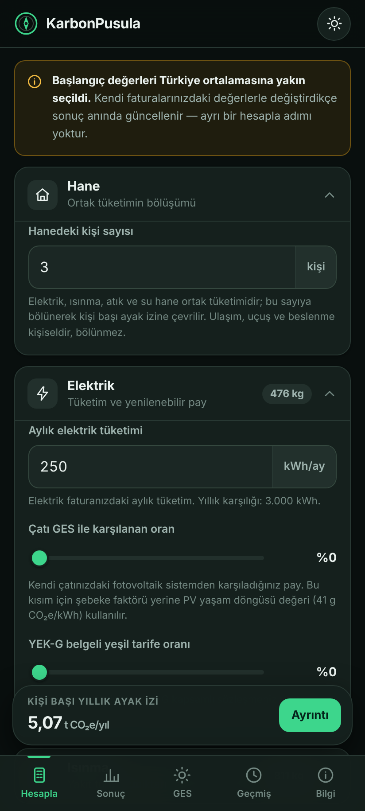
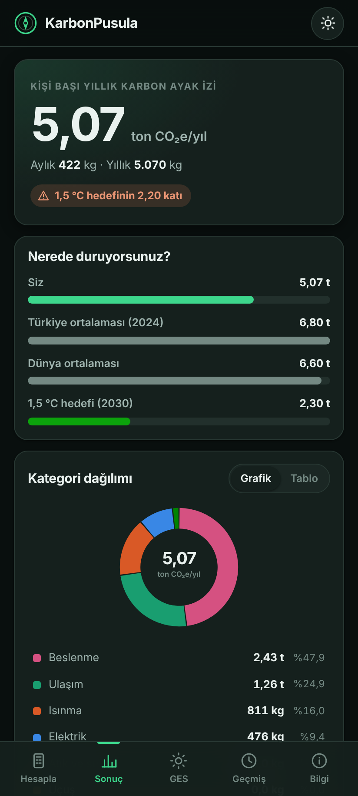
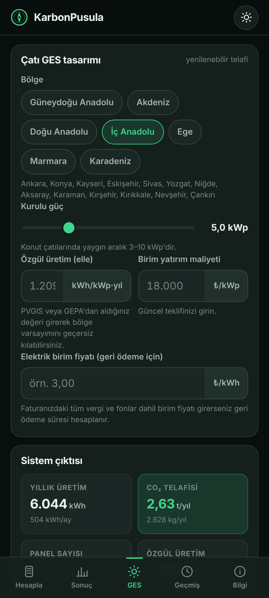

<div align="center">


# KarbonPusula

**Türkiye'ye uyarlanmış, kaynaklı emisyon faktörleriyle çalışan kişisel karbon
ayak izi hesaplama ve çatı GES telafi uygulaması.**

Yenilenebilir Enerji Teknikerliği bitirme projesi · Sürüm 2.0.0

</div>

---

## Ne yapar?

Altı kategoride (elektrik, ısınma, ulaşım, uçuş, beslenme, atık ve su) kişi başı
yıllık karbon ayak izini hesaplar; sonucu Türkiye ortalaması ve 1,5 °C hedefiyle
karşılaştırır; en etkili azaltım adımlarını azaltım potansiyeline göre sıralar.

Ayırt edici yanı **çatı GES modülüdür**: seçilen bölge ve kurulu güç için yıllık
üretimi, panel sayısını, gereken çatı alanını, net CO₂ telafisini ve geri ödeme
süresini hesaplar — tüketimi sıfırlamak için kaç kWp gerektiğini gösterir.

Uygulama **tamamen çevrimdışıdır** ve **hiçbir Android izni istemez**. Girilen
veriler cihazdan çıkmaz.

<div align="center">

| Hesapla | Sonuç | GES |
|---|---|---|
|  |  |  |

</div>

---

## Hızlı başlangıç

**Arayüzü hemen görmek için** — kurulum gerekmez:

```
android/app/src/main/assets/index.html
```

Bu dosyayı tarayıcıda açın. Uygulama telefondakiyle birebir aynı çalışır.

**APK üretmek için:** [dokumantasyon/APK_DERLEME_KILAVUZU.md](dokumantasyon/APK_DERLEME_KILAVUZU.md)
(üç yol anlatılıyor; en kolayı GitHub Actions ile bulutta derlemek).

**Testleri çalıştırmak için:**

```bash
node tests/test_hesap.js          # 62 birim testi
python3 tests/test_dogrulama.py   # 48 çapraz doğrulama testi
```

---

## Öne çıkanlar

**Her sayının kaynağı var.** 32 emisyon faktörünün her biri kurum, yıl, birim ve
kapsam bilgisiyle birlikte uygulamanın Bilgi ekranında listelenir. Türetilmiş
değerlerin türetme adımı tek tek yazılıdır.

**Türkiye'ye uyarlanmış.** Elektrik için Ember'in Türkiye şebeke faktörü (0,476
kg CO₂e/kWh). Elektrikli ve LPG'li araç faktörleri Türkiye şebekesiyle yeniden
türetilmiştir — yabancı araçların yaptığı gibi Birleşik Krallık değeri
kullanılmaz; o faktör elektrikli aracı gerçekte olduğundan ~3,6 kat temiz
gösterirdi.

**Doğru şebeke faktörü.** Bakanlığın CDM yöntemiyle hesapladığı marjinal faktör
(0,6345 tCO₂/MWh) proje bazlı azaltım içindir; bireysel tüketim ayak izinde
ortalama faktör kullanılır. İkisinin karıştırılması ~%33 fazla tahmine yol açar.

**Çift motorla doğrulanmış.** Hesap motoru JavaScript ve Python'da bağımsız
olarak iki kez yazıldı ve 28 senaryoda karşılaştırıldı. Bu yöntem gerçek bir hata
yakaladı: JS motoru yıldaki hafta sayısı için yuvarlanmış sabit kullanıyordu.

**Harici kütüphane yok.** Grafikler elle yazılmış SVG, yazı tipi sistem yazı
tipi. APK ≈ 1,5 MB.

---

## Dosya yapısı

```
KarbonPusula/
│
├── veriler/
│   └── emisyon_faktorleri.json      ★ Tek doğruluk kaynağı — 32 faktör, 11 kaynak
│
├── android/                          Android uygulaması
│   ├── gradlew / gradlew.bat         Gradle sarmalayıcı (ayrıca kurulum gerekmez)
│   └── app/src/main/
│       ├── assets/                   Arayüzün tamamı
│       │   ├── index.html
│       │   ├── css/app.css
│       │   └── js/
│       │       ├── veri.js           JSON'dan otomatik üretilir
│       │       ├── hesap.js          ★ Hesap motoru (arayüzden bağımsız)
│       │       ├── grafik.js         SVG grafikler
│       │       ├── depolama.js       Yerel depolama
│       │       └── ui.js             Arayüz
│       ├── java/com/karbonpusula/app/
│       │   ├── MainActivity.java     WebView kabuğu, pencere boşlukları
│       │   ├── Kopru.java            Paylaşım / rapor köprüsü
│       │   └── KarbonPusulaUygulama.java
│       └── res/                      İkon, tema, renkler, bildirim
│
├── scripts/
│   ├── veri_uret.py                  JSON → veri.js
│   ├── karbon_hesaplama.py           ★ Bağımsız Python motoru (doğrulama)
│   └── ikon_uret.js                  Uygulama ikonu bitmapleri
│
├── tests/
│   ├── test_hesap.js                 62 birim testi
│   └── test_dogrulama.py             48 çapraz doğrulama testi
│
├── dokumantasyon/
│   ├── YONTEM_VE_KAYNAKCA.md         ★ Formüller, türetmeler, kaynakça
│   ├── APK_DERLEME_KILAVUZU.md       APK üretmenin üç yolu
│   ├── PROJE_RAPORU_TASLAGI.md       Bitirme raporu iskeleti
│   ├── SUNUM_NOTLARI.md              Savunma hazırlığı ve olası sorular
│   └── gorseller/                    Ekran görüntüleri, ikon
│
├── .github/workflows/android.yml     Bulutta otomatik APK derleme
└── arsiv/                            Projenin önceki Streamlit sürümü
```

---

## Veri akışı

Tüm emisyon faktörleri **tek bir dosyada** tutulur. Uygulamanın veri modülü
bundan otomatik üretilir; Python doğrulama motoru aynı dosyayı doğrudan okur.

```
veriler/emisyon_faktorleri.json
        │
        ├─ scripts/veri_uret.py ──→ assets/js/veri.js   (uygulama)
        └─ doğrudan okunur ───────→ scripts/karbon_hesaplama.py  (doğrulama)
```

Faktör güncellemek için yalnızca JSON düzenlenir:

```bash
# 1. veriler/emisyon_faktorleri.json dosyasını düzenleyin
python3 scripts/veri_uret.py        # 2. uygulama verisini yeniden üretin
node tests/test_hesap.js            # 3. sınayın
python3 tests/test_dogrulama.py
```

Testler iki dosyanın eşleştiğini denetler; eşleşmiyorsa GitHub Actions derlemeyi
durdurur. Böylece bir faktörün bir yerde güncellenip başka yerde eski kalması
yapısal olarak imkânsızdır.

---

## Hesap yöntemi

```
emisyon = faaliyet verisi × emisyon faktörü
```

Tüm faktörler IPCC AR5 GWP-100 temelinde CO₂ eşdeğerine çevrilmiştir. Elektrik,
ısınma, atık ve su hane düzeyinde ölçülüp kişi sayısına bölünür; ulaşım, uçuş ve
beslenme kişiseldir.

GES modülü:

```
E [kWh/kWp·yıl] = GHI × K_eğim × PR        K_eğim = 1,15   PR = 0,80
net telafi      = EF_şebeke − EF_PV = 0,476 − 0,041 = 0,435 kg CO₂e/kWh
```

Ayrıntı, türetmeler ve kaynakça:
**[dokumantasyon/YONTEM_VE_KAYNAKCA.md](dokumantasyon/YONTEM_VE_KAYNAKCA.md)**

---

## Referans sonuç

3 kişilik hane · Ankara · doğal gaz ısıtma · benzinli otomobil · dengeli beslenme

| Kategori | kg CO₂e/yıl | Pay |
|---|---:|---:|
| Beslenme | 2.429 | %40,6 |
| Ulaşım | 1.560 | %26,1 |
| Isınma | 946 | %15,8 |
| Elektrik | 533 | %8,9 |
| Uçuş | 413 | %6,9 |
| Atık ve su | 98 | %1,6 |
| **Toplam** | **5.979** | |

**5,98 ton CO₂e/kişi·yıl** — TÜİK 2024 Türkiye ortalamasının (6,8 t) %88'i,
1,5 °C hedefinin (2,3 t) 2,60 katı.

---

## Teknik künye

| | |
|---|---|
| Paket | `com.karbonpusula.app` |
| Android | 7.0+ (API 24) · hedef API 35 |
| İzinler | **Yok** |
| APK | ≈ 1,5 MB |
| Dil | Türkçe |
| Tema | Açık / koyu / sistem |

---

## Kaynaklar

Ember · DESNZ/DEFRA · T.C. Enerji ve Tabii Kaynaklar Bakanlığı · IPCC ·
Poore & Nemecek (Science, 2018) · TÜİK · Meteoroloji Genel Müdürlüğü ·
GEPA · World Bank/ESMAP · EDGAR/JRC · IEEP & SEI

Tam künyeler:
[dokumantasyon/YONTEM_VE_KAYNAKCA.md § 8](dokumantasyon/YONTEM_VE_KAYNAKCA.md#8-kaynakça)

---

> **Uyarı.** Sonuçlar tahmindir ve resmî sera gazı raporlaması yerine geçmez.
> Kurumsal raporlama için ISO 14064 / GHG Protocol uyumlu doğrulanmış envanter
> gerekir. Kapsam dışı bırakılan kalemler
> [YONTEM_VE_KAYNAKCA.md § 5](dokumantasyon/YONTEM_VE_KAYNAKCA.md#5-kapsam-dışı-bırakılanlar)
> bölümünde listelenmiştir.
